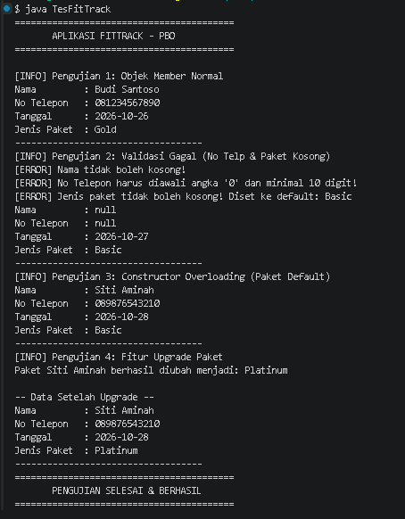

# FitTrack – Tugas 1 Praktikum Pemrograman Berorientasi Objek

**FitTrack** merupakan aplikasi manajemen member fitness sederhana berbasis Java yang dikembangkan untuk memenuhi tugas 1 Praktikum Pemrograman Berorientasi Objek (PBO).

## Identitas Mahasiswa
- **Nama Lengkap:** Kyandaru Annisa Putri
- **NPM:** 250810701100059
- **Kelas Praktikum:** Praktikum Pemograman Berorientasi Objek (PBO) A

## Deskripsi Proyek

FitTrack adalah aplikasi berbasis konsol yang dirancang untuk mempermudah proses pencatatan dan pengelolaan data member fitness secara terstruktur.

Program ini memungkinkan pengguna untuk mengelola informasi member, melakukan validasi data secara otomatis, serta mengubah jenis paket langganan. Pengembangan aplikasi ini juga menjadi penerapan konsep dasar *Object-Oriented Programming* (OOP) menggunakan bahasa Java.

## Fitur Utama

- **Registrasi Member:** Membuat data member baru yang mencakup nama, nomor telepon, tanggal pendaftaran, dan jenis paket.
- **Validasi Data:** Memastikan data yang dimasukkan sesuai dengan ketentuan, seperti nama tidak boleh kosong dan nomor telepon harus valid.
- **Default Package:** Memberikan jenis paket `Basic` secara otomatis apabila paket tidak diisi.
- **Constructor Overloading:** Mendukung pembuatan objek dengan parameter lengkap maupun parameter minimal.
- **Upgrade Paket:** Memungkinkan perubahan jenis paket langganan member melalui method `upgradePaket()`.

## Konsep OOP yang Diterapkan

| Konsep | Lokasi Penerapan | Penjelasan |
|---|---|---|
| **Encapsulation** | `Member.java` | Menggunakan atribut `private` serta method Getter dan Setter untuk melindungi data internal objek. |
| **Input Validation** | `Member.java` | Memastikan data yang dimasukkan memenuhi aturan validasi, seperti panjang minimal nomor telepon dan awalan angka `0`. |
| **Constructor Overloading** | `Member.java` | Menyediakan beberapa constructor agar objek dapat dibuat dengan parameter yang berbeda. |
| **Separation of Concerns** | `Member.java` dan `TesFitTrack.java` | Memisahkan pengelolaan data member dengan class pengujian agar kode lebih terstruktur. |

## Struktur Proyek

```text
FitTrack/
│
├── images/
│   └── output.png          # Screenshot hasil eksekusi program
│
├── src/
│   ├── Member.java         # Class model
│   └── TesFitTrack.java    # Class driver/testing
│
├── .gitignore
└── README.md               # Dokumentasi proyek
```

## Prasyarat

Sebelum menjalankan program, pastikan perangkat telah memiliki:

- **Java Development Kit (JDK):** Versi 17 atau lebih baru.
- **IDE (Opsional):** IntelliJ IDEA atau Visual Studio Code.
- **Terminal:** Command Prompt, PowerShell, atau terminal lainnya.

## Cara Menjalankan Program

### 1. Melalui Command Line (Terminal / CMD)

**Langkah 1.** Masuk ke direktori `src`:

```bash
cd src
```

**Langkah 2.** Kompilasi seluruh file Java:

```bash
javac Member.java TesFitTrack.java
```

**Langkah 3.** Jalankan program:

```bash
java TesFitTrack
```

### 2. Melalui IntelliJ IDEA

1. Buka folder proyek FitTrack di IntelliJ IDEA.
2. Pastikan folder `src` telah ditandai sebagai *Sources Root*.
3. Buka file `TesFitTrack.java`.
4. Klik ikon **Run (▶)** pada method `main()` untuk menjalankan program.

## Contoh Output Program

Berikut merupakan dokumentasi hasil eksekusi aplikasi FitTrack melalui terminal, mulai dari pengujian data member normal, validasi input, hingga simulasi upgrade paket.



## Ketentuan Nilai Default

Apabila jenis paket tidak diisi atau tidak memenuhi ketentuan validasi saat pembuatan objek, sistem akan secara otomatis menetapkan **`Basic`** sebagai nilai default.

Sistem juga menampilkan pesan peringatan melalui konsol untuk memberikan informasi mengenai perubahan tersebut.

## Batasan dan Pengembangan Selanjutnya

**Batasan Saat Ini:**
- Penyimpanan data masih bersifat sementara (*in-memory*).
- Data member belum terhubung dengan database maupun file eksternal seperti `.txt` atau SQL.
- Program masih menggunakan antarmuka berbasis konsol (*Command Line Interface*).

**Pengembangan Selanjutnya:**
- Menambahkan fitur penyimpanan data menggunakan database atau file eksternal.
- Mengembangkan antarmuka pengguna berbasis GUI.
- Menambahkan fitur pengelolaan dan pencarian data member.

